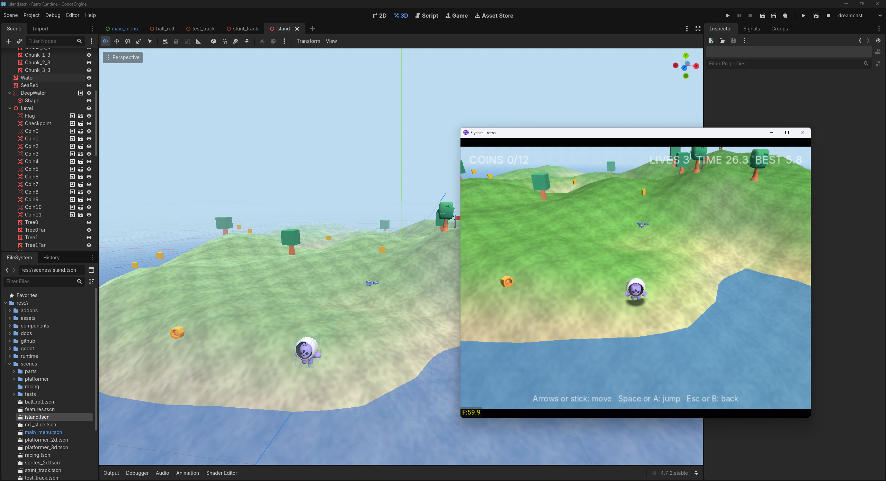

# Godot Retro Runtime

A small game runtime in C for retro consoles, with the stock Godot 4 editor as its front end. Scenes are built in Godot, exported by an addon into a compact binary package, and loaded by our own runtime on the target. The runtime contains no Godot code, and Godot never runs the game.




```
Godot editor (stock)                         Target
+---------------------------+                +-----------------------------+
| scenes, inspector, signals|                | game components (C)         |
| addon: exporter + bakers  | -- package --> | runtime core (portable C)   |
+---------------------------+                | platform layer (per target) |
                                             +-----------------------------+
```

Game logic is written in C as components. Each component has a tiny placeholder script in
the Godot project, so that it can be attached to a node and its fields show in the
inspector. What a scene uses that the runtime cannot handle stops the export with a
message that names the node.

## Status

| Target    | Graphics           | State                                                    |
|-----------|--------------------|----------------------------------------------------------|
| PC        | raylib             | Windows and Linux: builds, runs, covered by `make test`  |
| Dreamcast | PVR through KallistiOS | builds and runs in Flycast at 60 fps in the demos that were measured; two demos were looked at on a real console; sound has not been listened to |
| PSP       | GU of the PSP SDK  | builds and runs in PPSSPP: all demos are drawn and the feature scene passes; not tried on a real console, sound has not been listened to |
| Wii       | GX through libogc  | builds and runs in Dolphin: all demos are drawn and the feature scene passes; not tried on a real console, sound has not been listened to |

The milestones M1 (vertical slice) and M2 (a menu and a drive) are met. Since then the
work went into covering more of Godot's nodes: 2D and 3D scenes, UI controls, physics
bodies, animation with blending and skinning, audio buses, tile maps, translations. The repository holds small demos instead (two
platformers, a race, an island, a ball course, a stunt track).

## Quick start

On the PC, from an MSYS2 MINGW64 shell (Windows) or a normal shell (Linux) in the
repository root, with Godot 4.7.2 in `godot/`:

```
make raylib     # once: download raylib into third_party/
make            # build the runtime and the tools
make packages   # export the game scenes with Godot (headless)
make run        # start the game
make test       # exporter, loader and game flow tests
```

In the editor, enable the addon and use its play buttons in the toolbar above the
viewport: they export the game or the open scene and start it in the runtime or an
emulator. [docs/building.md](docs/building.md) has the details, the console builds
included.

## Documentation

| Document | What is in it |
|----------|---------------|
| [docs/building.md](docs/building.md) | pinned versions, building for PC and the consoles, running from the editor, packaging, runtime options |
| [docs/scenes.md](docs/scenes.md) | which Godot nodes and properties are supported, and how: the node table, instancing, resources and saved games, light bake, animations, particles, collision |
| [docs/components.md](docs/components.md) | writing a C component and its placeholder script |
| [docs/terrain.md](docs/terrain.md) | ground with hills: the `HeightTerrain` editor helper |
| [docs/demos.md](docs/demos.md) | the demos in this repository and their controls |
| [docs/dreamcast-backend.md](docs/dreamcast-backend.md) | how the PVR backend works and what was measured |
| [docs/psp-backend.md](docs/psp-backend.md) | how the PSP backend works: the screen size, clipping, sound, and what was checked |
| [docs/wii-backend.md](docs/wii-backend.md) | how the Wii and GameCube backend works: byte order, textures, input, and what was checked |
| [docs/package-format.md](docs/package-format.md) | the binary package format, the contract between exporter and runtime |

## Layout

```
addons/retro_runtime/   the editor addon: exporter, per-platform bakers, play buttons,
                        command line entry points
components/             placeholder scripts of the C components (declarations only)
scenes/                 the demo scenes; scenes/tests/ are inputs of the tests
assets/                 test images and sounds, and the Kenney assets of the demos
runtime/core/           portable C: package loader, scene, components, rendering, UI, ...
runtime/platform/       pc/ (raylib), dreamcast/ (KallistiOS), psp/ (PSP SDK), wii/ (libogc)
runtime/game/           the components of the demos and tests
runtime/third_party/    code of others: picophysics, the physics engine behind RigidBody3D
tools/                  rpkdump (C), and scripts that build the demo and test scenes
tests/                  expected output and recorded input of the tests
docs/                   the documents listed above
```
